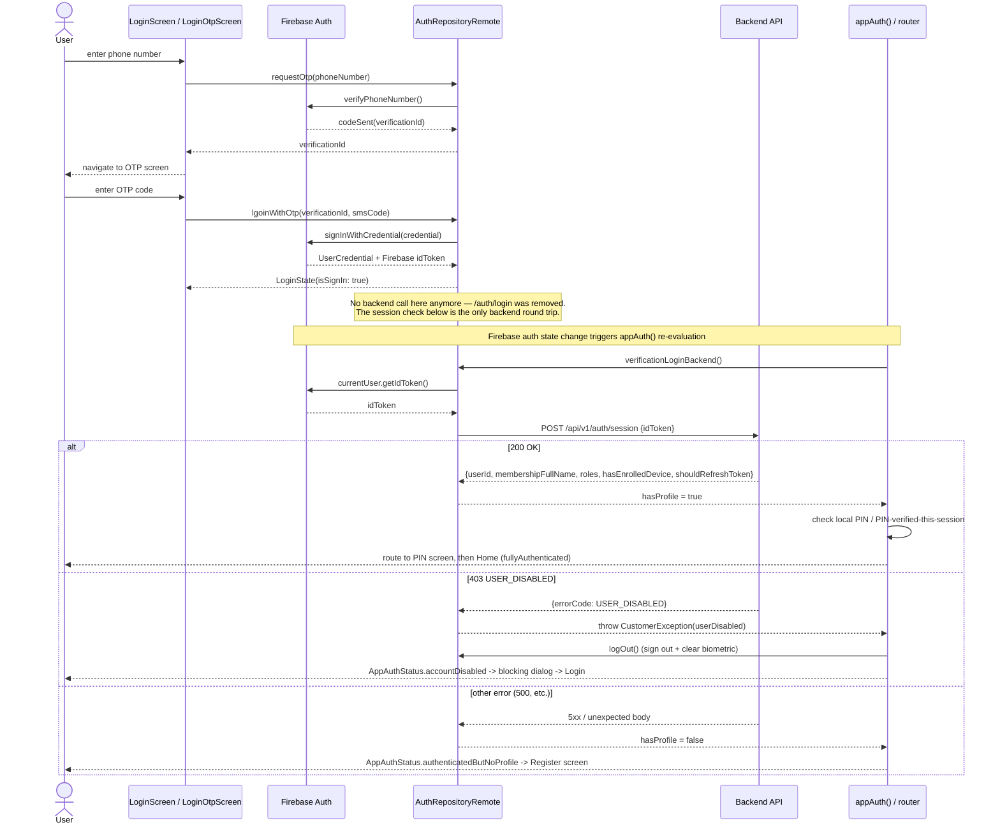
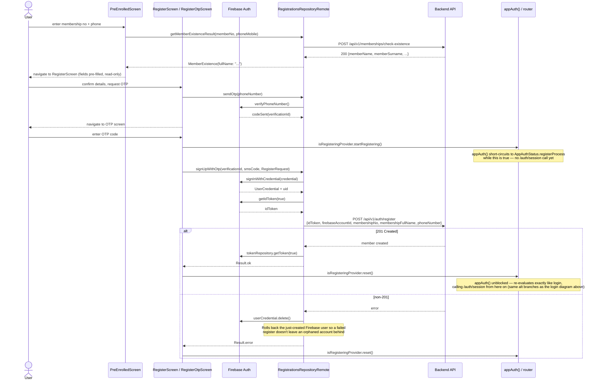

# Auth session verification (`/api/v1/auth/session`)

Read this before touching login, registration, the `appAuth`/`AppAuthStatus`
routing gate, or anything that decides "is this Firebase user actually a
member of ours." It documents the move from a boolean "verify" check to a
real session endpoint, the register request payload, and the one business
error (`USER_DISABLED`) that needs to be handled
differently from every other API failure in this app.

## What changed and why

The app used to call `GET /api/v1/auth/verify`, which returned only
`{ "isLogin": bool }`. That was never really "verification" — it was a gate
the router used to decide whether the signed-in Firebase user already had a
backend member profile.

That endpoint is now `POST /api/v1/auth/session`, body `{ "idToken": "..." }`.
A `200` now returns the actual session payload instead of a bool:

```json
{
  "userId": "3f2a1b4c-...",
  "membershipFullName": "สมชาย ใจดี",
  "roles": ["Admin", "Approver"],
  "hasEnrolledDevice": false,
  "shouldRefreshToken": true
}
```

So "verifying" and "establishing the session" are the same call now — there's
no separate lightweight check. `AuthLoginVerificationApiModel`
(`lib/data/services/api/model/auth/auth_login_verification_api_model.dart`)
and its domain mirror `LoginVerification`
(`lib/domain/models/auth/login_verification.dart`) both carry the full
payload, even though today only "did this succeed" is consumed by the router
— `roles`, `hasEnrolledDevice`, and `shouldRefreshToken` are there for the
next feature that needs them, not speculative additions.

**This call isn't one-shot.** `AuthApiClient.getSession()` is invoked every
time the `appAuth` provider (`lib/ui/auth/auth_controller.dart`) re-evaluates
— cold start, app resume, PIN retry, anything that touches its Riverpod
dependencies — and it always fetches a fresh Firebase ID token via
`_firebaseAuth.currentUser?.getIdToken()` in
`AuthRepositoryRemote.verificationLoginBackend()`
(`lib/data/repositories/auth/auth_repository_remote.dart`) rather than reusing
one from an earlier call.

## `POST /api/v1/auth/login` was removed

There used to be a separate `POST /api/v1/auth/login {idToken}` call —
`AuthApiClient.logIn()` — made right after Firebase OTP sign-in succeeded,
returning `AuthLoginApiModel {isAuthenticated, user{id, membershipNo,
accountStatus}, authenticationError}`. It's gone: `/auth/session` already
does everything that call was for (confirming the backend recognizes this
Firebase user), so keeping both meant two network round trips doing
overlapping work — one right after OTP, one again moments later when
`appAuth()` re-evaluates.

`AuthRepositoryRemote.lgoinWithOtp()`
(`lib/data/repositories/auth/auth_repository_remote.dart`) now returns
`Result.ok(const LoginState(isSignIn: true))` directly once Firebase sign-in
succeeds and an ID token is obtainable — no backend call at this step at all.
The actual "does this account exist / is it disabled" check happens exactly
once, in `appAuth()`'s call to `verificationLoginBackend()` → `/auth/session`,
the same call documented above.

This also deleted `LoginState.memberNo` and `LoginState.memberAccountStatus`
(`lib/domain/models/auth/login_state.dart`) — they existed only to carry
`/auth/login`'s response and had no other reader anywhere in the app. Along
with them, `AuthLoginApiModel`/`UserApiModel`
(`lib/data/services/api/model/auth/auth_login_api_model.dart`) and the
`MemberAccountStatus` enum (`lib/domain/models/auth/member_account_status.dart`)
were deleted outright rather than left as dead code — nothing referenced them
once `loginBackend()` was gone. If account-status-style data is needed again,
it should come from `/auth/session`'s payload, not a resurrected `/auth/login`.

## Login sequence



`/auth/session` is the only backend call in this flow, and it's re-run by
`appAuth()` on every app-state re-evaluation (cold start, foreground resume,
etc.), not just once right after login — it's the single source of truth for
the live session payload and the disabled-account check.

## The `USER_DISABLED` business error

Unlike every other endpoint in this codebase (which collapses any non-200
into a single generic `AppErrorType.apiError`), `/auth/session` returns a
typed error body on `403`:

```json
{
  "title": "User disabled",
  "status": 403,
  "errorCode": "USER_DISABLED",
  "traceId": "00-abc...",
  "instance": "/api/auth/session"
}
```

This is deliberately **not** treated the same as "no profile yet" (which
would incorrectly route a disabled, already-registered member into the
Register flow). Only `errorCode` is read today — `title`/`traceId`/`instance`
aren't captured anywhere, matching how the rest of the app's error handling
works; add that only if a real need for surfacing `traceId` (support
correlation, logging) comes up. Every other status code, including `500`,
still falls back to the generic `apiError` path — that was an explicit choice
to keep scope small rather than build out full RFC7807 handling for a
single field.

### How it flows end to end

1. `AuthApiClient.getSession()` parses the `403` body; if
   `errorCode == 'USER_DISABLED'`, it returns
   `Result.error(CustomerException(AppErrorType.userDisabled))`.
2. `AuthRepositoryRemote.verificationLoginBackend()` passes that error through
   unchanged — note it does **not** use the `throw Exception(result.error)`
   pattern seen elsewhere in this repo (e.g. `registrations_repository_remote.dart`),
   because that pattern re-wraps the error in a plain `Exception`, losing the
   `CustomerException` type the next layer needs to switch on.
3. `LoginVerificationViewmodel.verificationLogin()`
   (`lib/ui/auth/login/view_models/login_verification_viewmodel.dart`)
   rethrows only that specific error; every other failure still collapses to
   `return false` (same "no profile" fallback as before).
4. `appAuth()` catches `CustomerException` specifically, checks
   `e.type == AppErrorType.userDisabled`, signs the user out via the existing
   `logOutProvider` (`lib/ui/auth/logout/logout_viewmodel.dart` — this also
   clears the per-account biometric flag, same as a manual logout), and
   returns the new `AppAuthStatus.accountDisabled`.
5. `router.dart` treats `accountDisabled` like `unauthenticated` for
   redirects (back to `Routes.login`), and separately its
   `ref.listen(appAuthProvider, ...)` callback shows a blocking,
   non-dismissible `AccountDisabledDialog`
   (`lib/ui/auth/account_disabled/account_disabled_dialog.dart`) via a
   module-level `rootNavigatorKey`, since that listener runs outside any
   widget's `build()` and has no `BuildContext` of its own.

By the time the dialog is visible, the user is already signed out — the
dialog is purely informational (single "ตกลง" button that just dismisses
it), not a confirmation step.

## Status reference

| `AppAuthStatus` | Meaning | Route |
|---|---|---|
| `unauthenticated` | No Firebase user, or session check failed for a reason other than `USER_DISABLED` (network error, `500`, etc.) | Login (and the whole Terms/PreEnrolled/Register/RegisterOtp/LoginOtp funnel) |
| `authenticatedButNoProfile` | Firebase-signed-in, but `/auth/session` returned a non-`USER_DISABLED` failure — treated as "not registered yet" | Same funnel as `unauthenticated` (Terms/PreEnrolled/Register/RegisterOtp/LoginOtp) — **not** just `Routes.register` directly |
| `accountDisabled` | `/auth/session` returned `403 USER_DISABLED`; already signed out | Login, with blocking dialog |
| `authenticatedButNoLocalPin` / `authenticatedButNeedsPin` | Session verified, PIN not set up / not entered this session | PIN screen |
| `fullyAuthenticated` | Everything checked out | Home |

`authenticatedButNoProfile` used to whitelist only `Routes.register` for
redirect purposes. That was a bug: the normal way to reach Register is
Login → Terms → PreEnrolled → Register, and none of those intermediate
routes were allowed, so a Firebase-signed-in-but-no-profile user (e.g. a
stray session left over from an earlier login attempt) got bounced straight
back to Login the instant they tried to walk that funnel — clicking
"register" from the login screen looked like it did nothing. Fixed in
`router.dart` by reusing the same `isAuthRoute` whitelist as
`unauthenticated`.

## The redirect callback used to bounce to Splash on *every* `appAuthProvider` reload, not just cold start

```dart
if (authState.isLoading) return Routes.splash;
```

This looks like a cold-start-only guard, but it isn't: `appAuthProvider` is
an ordinary `async` function, and **any** `async` function's `Future` can't
resolve synchronously — even one with no real `await` in it still reports
`AsyncLoading` for at least one microtask before settling. So this line
fires on *every* recompute of `appAuthProvider`, not just the first one.

That matters because a lot of things invalidate `appAuthProvider` mid-session
— anything it `ref.watch()`s, most notably `authStateStreamProvider`. A
concrete case: when registration fails at the backend,
`RegistrationsRepositoryRemote.createMemberRegister()` deletes the
just-created Firebase user as a rollback (see the "Registration sequence"
diagram above). That delete makes the Firebase auth stream emit a new value,
which invalidates `appAuthProvider`, which — for one microtask — reports
`isLoading: true` regardless of the fact the app was already past cold
start. The old code bounced to `Routes.splash` for that tick, tearing down
whatever screen was mounted (e.g. `RegisterOtpScreen`) before its own state
update (the `apiError` `AuthState` carrying the failure) could reach its
`ref.listen` callback — so the error snackbar's listener was gone before it
could fire. Once `appAuthProvider` then resolved to `unauthenticated`, the
redirect ran again with `currentLocation == Routes.splash`, which isn't in
`isAuthRoute`, so it bounced again to `Routes.login`. From the user's
perspective: register fails, no error shown, dumped back on the login
screen.

Fixed by only forcing Splash when there's no previous resolved value to fall
back on:

```dart
if (authState.isLoading && !authState.hasValue) return Routes.splash;
final status = authState.value ?? AppAuthStatus.unauthenticated;
```

Riverpod's generated `Future` providers carry the previous `AsyncData` through
a reload (`authState.hasValue` stays `true`, `authState.value` still returns
the last resolved `AppAuthStatus`), so once the app has loaded once, any
later transient reload just keeps using the last known status for the
redirect decision instead of forcing everyone through Splash — which also
means the current screen stays mounted long enough for its own error state to
actually reach the user.

## Why this design over a dedicated "disabled account" screen

A full screen was considered and deliberately skipped — a blocking
dialog + sign-out was judged sufficient for this error, and adding a new
route/screen for a single business-error case would have been scope beyond
what was needed. If disabled accounts need richer messaging (a reason,
a "contact us" link, etc.) later, revisit this rather than assuming the
dialog is the permanent answer.

## Register request payload (`POST /api/v1/auth/register`)

`RegisterApiModel`
(`lib/data/services/api/model/registrations/register_api_model.dart`) sends:

```json
{
  "idToken": "string",
  "firebaseAccountId": "string",
  "membershipNo": "string",
  "membershipFullName": "string",
  "phoneNumber": "string"
}
```

This used to be `memberName` + `memberSurname` as two separate fields; the
backend now takes one combined `membershipFullName`. That collapse happens at
the domain layer, not by string-concatenating on the way out:

- The domain model `RegisterRequest`
  (`lib/domain/models/registrations/register_request.dart`) has a single
  `memberFullName` field (`memberNo`, `phoneMobile`, `memberFullName`) — it
  was never two fields internally past this point.
- `RegistrationsRepositoryRemote.createMemberRegister()`
  (`lib/data/repositories/registrations/registrations_repository_remote.dart`)
  maps `request.memberFullName` straight to `membershipFullName` on the API
  model, alongside `idToken` (fresh Firebase ID token from the just-created
  user) and `firebaseAccountId` (`userCredential.uid`).
- The caller, `RegisterOtpVerify`
  (`lib/ui/register/widgets/register_otp_verify.dart`), builds that single
  `memberFullName` from `MemberExistence.fullName` — which is **not** a new
  field either. `MemberExistence`
  (`lib/domain/models/registrations/member_existence.dart`) already carried a
  combined `fullName` (`'${memberName} ${memberSurname}'`, built in
  `RegistrationsRepositoryRemote.getMemberExistenceResult()`) precisely
  because the pre-enrollment check screen needed it — this change just reused
  that existing field instead of introducing a second way to combine a name.

**`MemberExistence.memberName` / `.memberSurname` were left untouched.**
`RegisterForm` (`lib/ui/register/widgets/register_form.dart`) still displays
first name and last name as two separate read-only fields on the register
screen — that's the pre-enrollment lookup response, a different concern from
what gets sent back in the register request body, so splitting/combining one
doesn't require touching the other.

## Registration sequence

Registration never had a `/auth/login`-style step to remove — it was already
funneling through the shared gate this doc describes, which is worth being
explicit about since it's easy to assume `POST /api/v1/auth/register`
also establishes the session by itself. It doesn't:



1. `RegistrationsRepositoryRemote.createMemberRegister()` posts the payload
   above, then on success only calls `_tokenRepository.getToken(true)` to
   force-refresh the local Firebase ID token — it does not call
   `/auth/session` itself.
2. `RegisterViewmodel.verifyOtp()`
   (`lib/ui/register/view_models/register_viewmodel.dart`) flips
   `isRegisteringProvider` back to `false` in a `finally` block once
   `signUpWithOtp()` settles (success or failure).
3. That flip is what unblocks `appAuth()`
   (`lib/ui/auth/auth_controller.dart`) — while `isRegisteringProvider` is
   `true` it short-circuits to `AppAuthStatus.registerProcess` without
   calling `/auth/session` at all, specifically so registration doesn't race
   a session check against an account the backend hasn't finished creating
   yet.
4. Once unblocked, `appAuth()` re-evaluates exactly like it does after login:
   it calls `verificationLoginBackend()` → `POST /api/v1/auth/session`, and
   the same `AppAuthStatus` table above (PIN screen / `accountDisabled` /
   `fullyAuthenticated`) applies from there.

So login and register are two different ways to reach a Firebase-signed-in
user; from that point on, session establishment, `USER_DISABLED` handling,
and PIN gating are one code path, not two — see the "Login sequence" diagram
above for exactly what happens once `appAuth()` calls `/auth/session`.

## Security note: removing `/auth/login` didn't weaken anything

`/auth/session` performs the same server-side validation of the Firebase
`idToken` that `/auth/login` used to — that trust boundary (a member is only
recognized once the backend has independently verified the token, not just
because the client claims Firebase signed them in) is unchanged. The two
endpoints were doing overlapping work; removing one is a redundant-round-trip
cleanup, not a relaxed check. `LoginState.isSignIn` reflects Firebase sign-in
success only — it does not grant access by itself. The router's `redirect`
callback in `router.dart` re-reads `appAuthProvider` on every navigation
attempt (including the `context.go(Routes.home)` call in
`login_otp_verify.dart`), so even that direct navigation is still gated by
whatever `/auth/session` (or `USER_DISABLED`/PIN state) says — it cannot be
used to skip the session check.
