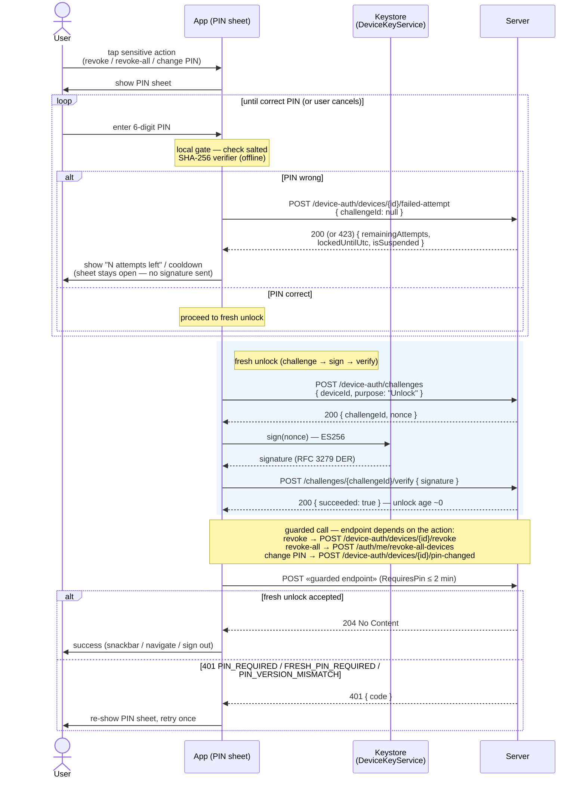

# PIN step-up — guarding a sensitive action

How to require a **fresh PIN** before a sensitive action (revoke a device, revoke
all devices, change PIN, …). This is the "step-up auth" pattern: the server marks
an endpoint `RequiresPin`, and the client must present a recent **unlock** (proof
the user just entered their PIN) when calling it.

For the underlying system (keys, enrol, timers) see
[device-auth.md](device-auth.md). This doc is the **how-to** for wiring a guarded
action.

## TL;DR

1. Show the PIN sheet → it creates a **fresh unlock** (`challenge → sign →
   verify`, resetting the unlock age to ~0).
2. Call the guarded endpoint **immediately** after.
3. On a `401` PIN-gate response, re-prompt the PIN and retry once.

```dart
final unlocked = await showPinConfirmSheet(context); // fresh unlock
if (!unlocked) return;
final result = await repo.revokeDevice(deviceId);     // call within 2 min
```

Never cache or reuse an old unlock for a `MaxAgeMinutes=2` endpoint — always
re-verify right before.

## Sequence



Each guarded action maps to exactly one endpoint:

| Action | Guarded endpoint | Freshness |
|---|---|---|
| Revoke one device | `POST /device-auth/devices/{id}/revoke` | ≤ 2 min |
| Revoke all devices | `POST /auth/me/revoke-all-devices` | ≤ 2 min |
| Change PIN | `POST /device-auth/devices/{id}/pin-changed` | any unexpired unlock |

## Which endpoints require a PIN

The server tags endpoints `RequiresPin`. Two freshness levels exist:

| Endpoint | PIN requirement | Client rule |
|---|---|---|
| `POST /device-auth/devices/{id}/pin-changed` | `RequiresPin` (sliding ~30 min) | Any unexpired unlock is fine; call it, and only re-verify if you get a 401 |
| `POST /device-auth/devices/{id}/revoke` | `RequiresPin(MaxAgeMinutes=2)` | Unlock must be **≤ 2 min old** → re-verify *immediately* before |
| `POST /auth/me/revoke-all-devices` | `RequiresPin(MaxAgeMinutes=2)` | Same — re-verify immediately before |

> `MaxAgeMinutes=2` resets **only** on a successful `verify`. Normal activity
> (sliding-window refresh) does **not** make an unlock "fresh" again. So for these
> endpoints, always run the PIN sheet right before the call.

## The unlock flow (what the sheet does)

A fresh unlock is three calls (handled by `DeviceAuthRepository.unlock`):

```
POST /device-auth/challenges              { deviceId, purpose: "Unlock" }
   → 200 { challengeId, nonce, expiresAtUtc }
sign nonce with the device key (ES256)
POST /device-auth/challenges/{id}/verify  { signature }
   → 200 { succeeded: true, unlockExpiresAtUtc, unlockAbsoluteExpiryUtc, ... }
```

Then the guarded call (e.g. revoke) passes the server's PIN gate because the
unlock age is ~0.

### Request / response shapes

`POST /device-auth/challenges`
```jsonc
// request
{ "deviceId": "…guid", "purpose": "Unlock" }   // purpose: "Unlock" | "StepUp" | "PinChange"
// 200
{ "challengeId": "…guid", "nonce": "<base64>", "expiresAtUtc": "2026-10-07T08:12:00Z" }
```

`POST /device-auth/challenges/{challengeId}/verify`
```jsonc
// request
{ "signature": "<base64 ASN.1/DER ECDSA signature of the nonce>" }
// 200 (succeeded) — also returned on 401 (wrong sig) / 423 (locked)
{
  "succeeded": true,
  "failureCode": null,
  "remainingAttempts": null,
  "lockedUntilUtc": null,
  "unlockExpiresAtUtc": "2026-10-07T08:42:00Z",      // sliding window
  "unlockAbsoluteExpiryUtc": "2026-10-07T12:12:00Z"  // hard ceiling
}
```

Guarded endpoints (no body → `204` on success):
```
POST /device-auth/devices/{id}/revoke        → 204
POST /auth/me/revoke-all-devices             → 204
POST /device-auth/devices/{id}/pin-changed   → 204
```

## Status codes

| HTTP | `code` | When | Client action |
|---|---|---|---|
| `200` / `201` / `204` | — | Success | Proceed |
| `401` | `INVALID_PIN` | **On `verify`** — wrong signature/PIN (+ `remainingAttempts`) | **Not a retry** — a failed unlock: show remaining attempts and let lockout count (see [Wrong PIN & lockout](#wrong-pin--lockout)) |
| `401` | `PIN_REQUIRED` | **On a guarded call** — no active unlock | Show PIN sheet → unlock → retry |
| `401` | `FRESH_PIN_REQUIRED` | **On a guarded call** — unlock older than `MaxAgeMinutes` | Show PIN sheet → unlock → retry |
| `401` | `PIN_VERSION_MISMATCH` | **On a guarded call** — PIN changed since this unlock | Show PIN sheet → unlock → retry |
| `403` | `DEVICE_MUST_BE_ACTIVE` | **On challenge / verify** — this device was revoked/suspended server-side | Local state stale → `clearLocal` + **re-enrol** |
| `423` | `DEVICE_LOCKED` / `DEVICE_SUSPENDED` | Too many wrong attempts (5 → lock, 10 → suspend) | Show cooldown / contact support |
| `404` | — | Device genuinely not found / not owned | Local state stale → **re-enrol** |
| `409` | `USER_CANNOT_EXCEED_DEVICE_LIMIT` | 5-device cap on enrol | Dead-end UI (revoke another / logout) |
| `429` | — | Rate limited (`pin-verify` limiter) | Back off and retry later |

Two different `401`s — don't conflate them:

- **`INVALID_PIN`** comes from the **`verify`** step and means the PIN/signature was
  wrong. It is returned as data (a non-succeeded `VerifyResult`), **not** retried —
  show remaining attempts, let the server count toward lockout.
- **`PIN_REQUIRED` / `FRESH_PIN_REQUIRED` / `PIN_VERSION_MISMATCH`** (the **PinGate**
  codes) come from a **guarded call** when the unlock is missing/stale/outdated —
  these three are handled the **same way**: re-verify and retry (only the message
  shown may differ).

Both `403 DEVICE_MUST_BE_ACTIVE` (revoked device) and a genuine `404` mean the
local state is stale → `clearLocal` and re-enrol (not a PIN retry).

## Wrong PIN & lockout

A wrong PIN is caught **locally** by the salted-SHA-256 verifier — it never
produces a signature and never calls `verify`. Instead the client reports it so
the server can drive the shared lockout counter:

```jsonc
POST /device-auth/devices/{id}/failed-attempt
// request
{ "challengeId": "…guid-or-null" }
// 200 (normal) — or 423 when it tips into lockout/suspension
{ "remainingAttempts": 3, "lockedUntilUtc": null, "isSuspended": false }
```

`DeviceAuthRepository.unlock` folds this back into a **non-succeeded**
`VerifyResult` (`succeeded:false`, `remainingAttempts`, `lockedUntilUtc`,
`failureCode`) — not an exception. The PIN sheet (`PinConfirmViewmodel`) then:

- shows "N attempts left", or
- starts a cooldown when `lockedUntilUtc`/`DEVICE_LOCKED`/`DEVICE_SUSPENDED` is set,

and stays open. Only a *correct* PIN proceeds to `challenge → sign → verify`.

**Server lockout policy** (the client only reflects it via `remainingAttempts` /
`lockedUntilUtc`): **5** consecutive wrong attempts → device **locked** (`423`,
`lockedUntilUtc` set); **10** → **suspended**.

> Reporting the failure is **mandatory** — the server's counter only advances when
> it hears about a wrong attempt. If a wrong signature ever reaches `verify`
> instead (bypassing the local gate), the server returns `401 INVALID_PIN` with
> `remainingAttempts` and counts it the same way; our client parses that 401 as a
> non-succeeded `VerifyResult` (identical UI). Either path keeps lockout working —
> never swallow a wrong PIN locally without reporting it.

## Flutter classes involved

| Class / file | Role |
|---|---|
| `showPinConfirmSheet(context)` · `lib/ui/device_management/widgets/pin_confirm_sheet.dart` | Shows the PIN sheet; resolves `Future<bool>` — `true` once a **fresh unlock** exists |
| `PinConfirmViewmodel` + `PinConfirmState` · `lib/ui/device_management/view_models/`, `lib/domain/models/device_auth/pin_confirm_state.dart` | Drives the sheet: enters PIN → `unlock` → `succeeded`/lockout; auto-disposes so each open is fresh |
| `DeviceAuthRepository.unlock(pin)` · `lib/data/repositories/device_auth/device_auth_repository.dart` | The unlock primitive (local PIN gate → challenge → sign → verify) |
| `DeviceAuthRepository.revokeDevice / revokeAllDevices / changePin` | The guarded actions |
| `DeviceAuthErrorCode` / `DeviceAuthException` · `lib/domain/models/device_auth/` | Typed 401/4xx result — branch on `error.code` to decide "re-prompt vs fail" |
| `VerifyResult` · `lib/domain/models/device_auth/verify_result.dart` | `succeeded`, `remainingAttempts`, `lockedUntilUtc`, unlock expiries |

## Recipe: guard an action with a fresh PIN

Real pattern from `lib/ui/device_management/screen/device_management_screen.dart`.
Run the sheet, call the action, and retry once on a PIN-gate 401:

```dart
Future<void> guardedRevoke(
  BuildContext context,
  WidgetRef ref,
  String deviceId,
) async {
  final messenger = ScaffoldMessenger.of(context);
  final repo = ref.read(deviceManagementViewmodelProvider.notifier);

  for (var attempt = 0; attempt < 2; attempt++) {
    // 1. Fresh unlock (≤ 2 min old).
    final unlocked = await showPinConfirmSheet(context);
    if (!unlocked || !context.mounted) return;

    // 2. Call the guarded endpoint immediately.
    final result = await repo.revokeDevice(deviceId);
    if (!context.mounted) return;

    if (result is Ok<void>) {
      messenger.showSnackBar(const SnackBar(content: Text('นำอุปกรณ์ออกแล้ว')));
      return;
    }

    // 3. PIN-gate 401 → re-prompt and retry once; anything else → fail.
    final error = (result as Error<void>).error;
    final isPinGate =
        error is DeviceAuthException &&
        const {
          DeviceAuthErrorCode.pinRequired,
          DeviceAuthErrorCode.freshPinRequired,
          DeviceAuthErrorCode.pinVersionMismatch,
        }.contains(error.code);
    if (isPinGate && attempt == 0) continue;

    messenger.showSnackBar(const SnackBar(content: Text('ทำรายการไม่สำเร็จ')));
    return;
  }
}
```

Change-PIN uses the same `unlock` primitive directly to prove the current PIN
before `changePin` — see `lib/ui/change_pin/view_models/change_pin_viewmodel.dart`
(`_verifyCurrentPin` → `unlock`, then `_savePin` → `changePin`).

## Pitfalls

- **Don't reuse a stale unlock** for a `MaxAgeMinutes=2` action — always re-verify
  right before. Our PIN sheet auto-disposes so every open starts fresh.
- **Call immediately after the sheet** — no long awaits between `verify` and the
  guarded call, or you risk drifting past 2 minutes.
- **Handle all three 401 codes identically** (re-verify + retry); don't special-case
  only `FRESH_PIN_REQUIRED`.
- A **wrong PIN is not an exception** — it comes back as a non-succeeded
  `VerifyResult` with `remainingAttempts`; the sheet shows attempts/lockout and
  stays open.
